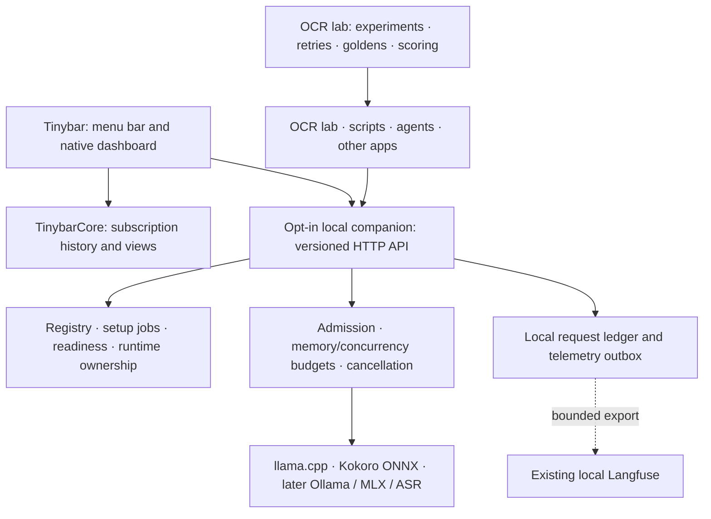

# Tinybar Local project

Status: kickoff prepared; architecture review and implementation remain pending. No local-model feature code.
Owner: Jay. Review date: 16 November 2026. Upstream base: `4492996` (Tinybar 0.15.0).
The installed Tinybar inspected on this Mac is 0.14.2; compatibility cannot be assumed from the fork version.

## Current work

- Done: fork, initial README/architecture/milestone plan, shared AGENTS.md, Claude entry pointer and
  [kickoff agenda / first task](docs/kickoff.md).
- Now: review the scope and start M1.1, fork identity/data/update isolation, in a Tinybar project session.
- Next: subscription baseline and native dashboard design, then M2 contracts/discovery.
- Running: no implementation or background task from this initialization.
- Decisions: owner, in session, chose the Tinybar fork with a local companion; requested kickoff and
  agent setup on 16 November 2026. Detailed design, API and storage choices remain as marked below.

## Outcome and scope

One native Tinybar dashboard lets Jay see local models, install or register them, choose a model
for an app or task, check inference, and inspect usage and request flows alongside Claude/Codex
subscription usage. Apps and scripts get one documented local API instead of knowing model ports,
launch commands, and storage paths.

This is a personal tool in its own repository, not a Draftbook initiative. Existing Tinybar
subscription monitoring continues with read-only credentials. Existing research evidence stays owned
by the OCR Review Lab. First delivery targets this Apple Silicon Mac; Intel support for local
runtimes and remote/LAN access are deferred.

## Initial inventory

Observed on 16 November 2026, before this fork. These are observations, not a live status page.
Hardware: M4 Max Mac Studio, 128 GB unified memory. No benchmark was started for this plan.

| Component | Observation | First integration |
|---|---|---|
| Tinybar 0.14.2 | Running; SQLite holds Claude/Codex usage and limits | Reuse existing ingestion and views; safe read-only history import |
| llama.cpp b11960 | MiniCPM OCR :18881, Jev :18882, Gemma :18884, Qwen :18888 running | Discover and register as externally managed |
| OCR bridges | Jev renderer :18883 and SDK layout :18887 healthy | Explicit OCR/scoring adapters; retain pipeline semantics |
| Gemma / Qwen | Tiny text calls passed, 1.30 s / 0.61 s with reported usage | Smoke-check examples, not performance claims |
| OCR Review Lab | Docker dashboard :3200, API/worker :8200 | First application client, after direct API proof |
| Langfuse 4.72.0 | :18890 healthy, but lab API reports tracing unavailable | Diagnose connection, verify persisted observation |
| Kokoro | Python/ONNX weights verified; local speech and playback passed | Managed speech adapter preserving the existing CLI |
| Hex / Bark | Installed; about 1.1 GB Core ML weights present | Discover only initially; transcription integration needs a supported adapter |
| Ollama | :11434 running, no models installed | Optional later adapter; do not pull models automatically |
| Other tools | GullyGuru MLX setup and AgentBox LiteLLM configuration exist; no running service found | Prior art; do not start another proxy by default |
| Other weights/studies | GLM-4.7-Flash, TwIL, Qwen2.5 7B/14B files cached; other historical studies exist | Distinguish cached files, measured studies, and runnable endpoints |

The OCR lab's .cache/models is about 50 GB and .cache/open-mapper about 9.8 GB. These are directory
measurements, not a deduplicated disk total. No cleanup, moves, or re-downloads are part of initialization.
TwIL and Bark have research/non-commercial restrictions; retain source licence evidence and purpose.
Indra has no verified selectable standalone endpoint in the lab. Historical GLM-OCR and Liquid studies
are not deployed models. Saved Nemotron OCR is evidence reuse, not fresh inference.

Evidence to consult during implementation: sibling `ocr-review-lab/docs/{ARCHITECTURE,MODELS,TRACING}.md`,
its runtime lock files and catalogue; `bark-dictate/README.md`; `GullyGuru/scripts/run-commentary-mlx-server.sh`;
`~/.local/share/kokoro/README.md`. Machine-local observations must be refreshed before operational actions.

## Architecture

### Components and ownership

| Component | Proposed location / stack | Owns and hides |
|---|---|---|
| Dashboard | Extend `Sources/Tinybar` with AppKit/SwiftUI | Selection and settings UI, request/activity views; no inference execution |
| Subscription core | Existing `Sources/TinybarCore` | Providers, log ingestion, pricing, existing usage.sqlite; retain upstream behaviour |
| Local API contracts/client | Proposed `Sources/LocalModelCore` Swift target | Codable request/response/error types and client; capability and version vocabulary |
| Companion | Proposed `tinybar-local` Swift executable target | Setup, registry, runtime supervision, admission, inference, local request ledger and trace export |
| Runtime adapters | Companion internals, isolated environments for Python workers | Runtime-specific payloads, launch details, usage normalization and cancellation |
| Research client | OCR Review Lab, migrated separately | Experiment state, retries, provenance, local file evidence, scorer-only goldens |

Swift is the proposed host for the companion, sharing types with the app. Python remains in
isolated runtime workers where required. Select a maintained HTTP server library at M2 and record
its dependency/binary/idle costs before adding it. Reuse llama.cpp's current OpenAI-compatible
transport; do not add LiteLLM unless a demonstrated requirement earns another running service.

The companion runs independently, optionally as a per-user LaunchAgent, not a long-lived child
of the menu bar app. Runtime processes can live while it serves requests. This is an explicit
fork extension to upstream's process rules and needs a fork ADR before implementation.

### Persistence and ownership

- Keep the app's existing subscription database under its existing ingestion owner. Never point
  the inherited migrating UsageStore at the installed upstream app's database.
- Give the fork a separate bundle ID, application-support directory, launch-agent label and update
  channel before running it. Initially import upstream history through a read-only, version-aware
  SQLite snapshot; record provenance and incremental cursor. No second ingestion of the same totals.
- Companion owns a versioned registry and a separate SQLite request/job ledger. Database schema and
  retention are M2 decisions; do not create duplicate experiment state or copy invoice/golden data.
- Register existing weight paths first. Each artifact records source, revision, checksum, format,
  quantization, licence, capabilities and file location. Future downloads use verified temporary files
  and atomic completion; partial or mismatched downloads never become ready.
- Existing lab processes are externally managed. Display and route to them; do not stop, restart or
  alter them. Managed processes require owned launch receipts and identity checks before termination.
- Research clients freeze resolved artifact/runtime/configuration identity at dispatch. Mutable app
  defaults cannot change a frozen experiment; reject mismatches instead of substituting a model.

### Setup and selection

Discover/register → verify files and compatibility → check disk/memory/port → start if managed →
health probe → bounded capability-specific inference → select for task/app → observe usage.

Track installation, process health and inference verification as separate facts. A verified result
includes model/runtime identity, configuration, time and test outcome; invalidate it when those change.
Capabilities determine selectable tasks. Jev scores a supplied transcription; it is not a chat model.
Direct MiniCPM text does not imply layout boxes. An installed Hex model is not automatically an HTTP API.

### API, usage and request flows

One versioned loopback API serves native UI, scripts and project clients. Proposed surface:

| Interface | Purpose |
|---|---|
| `GET /health`, `GET /v1/models` | Service health, capabilities, availability and verification |
| `POST /v1/chat/completions` | OpenAI-compatible text/image requests, streaming and usage |
| `POST /v1/audio/speech` | Kokoro audio; the compatible CLI handles playback |
| `POST /v1/audio/transcriptions` | Later supported speech-recognition adapter |
| `POST /v1/ocr`, `POST /v1/score` | Explicit parsing/scoring semantics |
| `/api/models`, `/api/jobs`, `/api/selections` | Setup, lifecycle, tests and per-app/task defaults |
| `/api/requests`, `/api/usage`, `/api/events` | Request flows, aggregates and bounded live updates |

Freeze exact schemas, error codes, auth and Docker transport at M2. Management changes use expected
revisions; setup jobs have idempotency keys. Inference has deadlines, bounded queues and explicit
cancellation; it is not automatically retried or replayed after restart. Return unsupported, busy,
timeout and interrupted/uncertain results explicitly. Never silently substitute a model or cloud service.

Service credentials are independent of coding-subscription credentials. Validate Host/Origin, restrict
paths/endpoints, protect mutations and avoid permissive CORS. Docker clients need a tested local
bridge or host.docker.internal path without an unauthenticated LAN listener.

Every request records project/client/session, parent and attempt IDs, actual model/revision/runtime,
settings hash, timing, finish reason, errors and available token counts. Preserve runtime usage
categories to avoid counting cached/reasoning tokens twice. Missing usage is unknown, not zero;
estimates name their tokenizer/version. Track OCR pages and audio seconds separately. Keep actual
provider charges, subscription Theoretical Cost and local compute duration distinct. Define generation
speed separately from upstream's end-to-end Output Speed.

Persist local metadata before bounded Langfuse export; show pending/failed export and verify an actual
persisted observation. Trace outages cannot block inference. Prompt/output content is excluded by
default; invoice assets, credentials and scorer goldens never enter telemetry. Local lab attempts
remain authoritative evidence. Calls bypassing the service are untracked unless instrumented.
Imported daily subscription totals have their own provenance and must not be counted twice.

### One native dashboard window

| Area | Content |
|---|---|
| Overview | Active models, queue, memory pressure, daily usage and integration health |
| Models | Search/filter, artifact/source details, setup progress, settings, ownership, start/stop/test |
| Try | Capability-specific text/image/audio check, effective settings, result, timing and usage |
| Activity | Request → attempts → children; errors, cancelled/partial work, Langfuse link |
| Usage | Model/project/time breakdowns; subscription history and local usage with clear units/sources |
| Settings | Per-app/task model selections, runtime/storage paths, budgets, retention and startup |

One window with sections and a model details drawer; reuse existing Stats/settings patterns. No WebView
or separate web dashboard in the first delivery. Readiness tests and new inference require explicit
user actions. System monitoring is demand-driven while the dashboard is visible; no fast background
poll in the menu bar process. Show stale/disconnected data with its last observed time.

## Milestones

M0 documentation and agent setup are complete; its owner review remains open. Every implementation
item below is planned and unchecked.
Each milestone ends with a reviewable result and evidence; dependencies run in order.

### M0 — Initialize and review

- [x] Fork upstream into `naik-ai/tinybar`, clone under `/Users/jaynaik/src/tinybar`, retain upstream remote.
- [x] Inspect upstream targets, credential policy, usage store, build identity and existing dashboard.
- [x] Update README and record architecture, current inventory, boundaries and milestone checklist.
- [x] Add shared AGENTS.md, CLAUDE.md entry pointer and kickoff agenda with a bounded first task.
- [ ] Owner reviews this plan, scope and component choices before implementation.

### M1 — Safe fork foundation

- [ ] Add fork ADR for local inference, independent companion, and subscription credential separation;
      reconcile SPEC, CONTEXT and CONTRIBUTING for fork behaviour while preserving upstream attribution.
- [ ] Separate bundle/data/launch-agent identities; disable inherited upstream self-update/install behaviour
      for fork builds and document a fork update path.
- [ ] Build and run alongside installed Tinybar without writing its database or replacing its app.
- [ ] Record unchanged subscription tests and idle memory/CPU baseline; keep menu bar steady state under
      upstream's 50 MB target with local features disabled. Set dashboard/companion budgets from measurements.
- [ ] Owner reviews a native dashboard mock showing model selection, setup, usage and failure states.

Acceptance: both apps coexist; fork restart/update cannot replace upstream; subscription monitoring
still works, no model loads from opening the menu, design reviewed before UI implementation.

### M2 — Contracts, discovery and read-only dashboard

- [ ] Freeze API/error/event contracts, local transport/auth, HTTP dependency, storage and retention design.
- [ ] Discover lab servers, weight paths, Kokoro, Ollama and Hex; distinguish registered, downloaded,
      healthy, inference-tested, unavailable and historical/reused evidence.
- [ ] Add read-only Models/Overview, integration health and safe imported subscription usage.
- [ ] Prove the installed 0.14.2 database is read without mutation and duplicate history is not added.
- [ ] Recheck source revisions/licences; verify missing or stale artifacts remain unavailable.

Acceptance: one window displays the real inventory and tracing mismatch; absent runtimes and stopped
models are accurate; no launch, download, relocation or inference happens during discovery.

### M3 — Managed setup and readiness

- [ ] Verified resumable setup jobs, progress/cancellation, actionable failures and orphan recovery.
- [ ] Managed process receipts, occupied-port refusal, memory admission and per-runtime concurrency limits;
      reserve capacity for externally managed processes, whose memory estimates are not guaranteed exact.
- [ ] Capability-specific synthetic tests with recorded effective settings and identity.
- [ ] Per-app/task selections; validate revision and capability before dispatch.

Acceptance: partial/bad downloads cannot be selected; occupied ports and external PIDs are untouched;
crash recovery shows interrupted setup; changing artifact/settings invalidates its prior readiness.

### M4 — Common inference API and local usage

- [ ] First support existing Gemma/Qwen HTTP servers and Kokoro through the common API.
- [ ] Streaming, deadlines, cancellation, bounded queues and explicit partial/unknown usage.
- [ ] Durable request/attempt identities, restart recovery and attributed usage with deduplication.
- [ ] Native Try/Activity/Usage views and a documented minimal script/client example.
- [ ] Keep `kokoro say` compatible as a client; avoid loading another copy of the model per request
      when the managed worker can reuse one, subject to its measured idle/resource budget.

Acceptance: generate/stream Gemma or Qwen and synthesize Kokoro through one API; inspect attributed
counts/timings; cancelling and restarting never silently repeats inference or loses its terminal state.

### M5 — Tracing and first project integration

- [ ] Diagnose existing lab tracing-unavailable state without replacing credentials or existing evidence.
- [ ] Export correlated metadata to existing Langfuse with bounded retries and a visible outbox.
- [ ] Prove persisted traces and correct request duration; retain trace links and export status locally.
- [ ] Migrate one synthetic OCR-lab mapping path, preserving frozen identity, errors, attempts and token usage;
      verify Docker-to-host transport and leave experiment retries/scoring with the lab.
- [ ] Compare old/new adapter semantics with saved fixtures before any real invoice evaluation.

Acceptance: select model → synthetic mapping → dashboard request/tokens → matching persisted Langfuse
observation; Langfuse outage leaves inference usable; replayed evidence is never reported as a new call.

### M6 — Broader runtime support and operational finish

- [ ] Add specialized MiniCPM/Jev bridges; preserve layout/scoring distinctions and renderer identity.
- [ ] Add Ollama/MLX only as used; evaluate a supported Hex/Bark transcription bridge separately.
- [ ] Resource/idle-unload policy, explicit lifecycle takeover, optional per-user service startup and
      safe update/reconnect behaviour, with no forced cancellation of external research work.
- [ ] Retention/export controls, storage overview and optional verified consolidation plan; no automatic
      deletion of weights or research evidence.
- [ ] Measure menu bar/dashboard/service CPU and memory, concurrency, cold/warm latency, cancellation,
      restart, offline setup, tracing loss, and history accuracy against independent counts.
- [ ] Document setup, API examples, troubleshooting, supported runtime versions and known coverage gaps.

Acceptance: daily operation through Tinybar meets the agreed budgets and demonstrated integrations;
unsupported models and unobserved calls remain explicit. Real research evaluations stay separately authorized.

## Review decisions and deferred work

Review recommendation: native Tinybar fork plus an independent opt-in Swift companion; reuse current
model files/servers, subscription ingestion and Langfuse; no extra gateway service initially.
First scope: this Mac, read-only discovery, then Gemma/Qwen and Kokoro. No app installation in M0.
Before implementation, settle the M1 fork policy/identity and dashboard design; at M2, select the server
library, Docker transport, schema, retention defaults and measured budgets. These are not implemented facts.

Deferred: multi-user/LAN/cloud serving, hosted-model inference through subscription credentials,
automatic cloud failover, replacing Langfuse, a new experiment/scoring engine, model training,
automatic benchmark-based model selection, automatic file deletion, and a separate web dashboard.

## Validation of this initialization

Documentation-only: inspect diff, check Markdown local links/anchors, confirm fork/remotes/branch,
and verify no source, installed app, credentials, databases or model files changed. Runtime build,
Swift tests, UI tests and performance measurements are due with the milestones that change behaviour;
this initial plan does not claim they passed.
